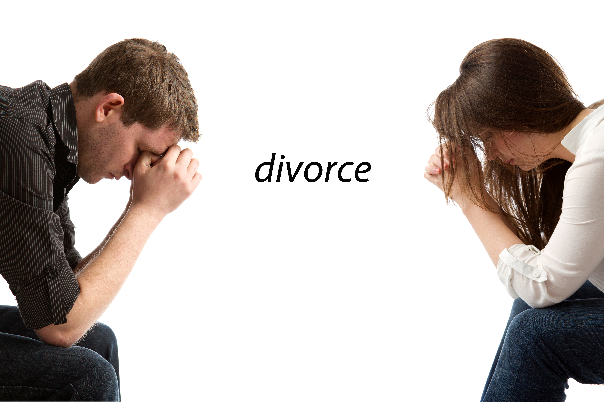

### Chicago Child Support Attorney

Parents of minor children who are unmarried, separated or divorced may pay or receive child support. In Illinois the parent who does not have primary residence of a child will usually be required to pay child support. Child support is determined by statutory factors; however, under certain circumstances a court may deviate from the statutory child support guidelines.

A residential parent may also seek contribution to health insurance coverage for the child, and contribution to medical expenses, contribution to day care or summer camp, and extracurricular activities. In certain circumstances the court may order contribution to private school tuition.

Law Offices of Annette M. Fernholz, P.C. counsels and assists clients who wish to obtain child support, enforce a child support order, or modify a child support.  Nonpayment of child support is grounds for child support enforcement which may result in holding the non-paying parent in contempt of court until payments are made.

### Modification of Support

Several factors can prompt child support modifications.  As children grow up, their needs, interests, and expenses change.  Modifications to increase child support can help parents satisfy the needs of their families.  An increase in the child’s needs and an increase in an obligor’s  income are necessary requirements for child support modification.

Conversely if your income has decreased or you have lost your job through no fault of your own, you have the right to seek a decrease in your child support payments. Law Offices of Annette M. Fernholz, P.C. can assist you with petitioning the court and seeking modification.

### Child Support Enforcement

Although a court order may require child support payments, reimbursement of medical expenses or payment of extracurricular activities by a specified date, this does not always mean payment will arrive on time.  If you are not receiving prompt payment, the Law Offices of Annette M. Fernholz,  can help you by seeking enforcement of the court order.  The failure to make timely payment may result in wage garnishment, suspension of driving privileges and under certain circumstances even incarceration for the non-paying parent.

The Law Offices of Annette M. Fernholz can act on your behalf to enforce child support orders when a parent fails to make child support payments. Conversely, if you have lost your job or your income has decreased, you need to obtain a court order to allow you to reduce your child support obligation. Call 312-683-0308 or email to learn more.

[Lawyer Annette Fernholz](http://www.avvo.com/attorneys/60606-il-annette-fernholz-1074821.html?utm_campaign=avvo_rating&utm_content=1074821&utm_medium=avvo_badge&utm_source=avvo) | [Featured Attorney Child Support](http://www.avvo.com/child-support-lawyer/il/chicago.html?utm_campaign=avvo_rating&utm_content=1074821&utm_medium=avvo_badge&utm_source=avvo)

[Lawyer Annette Fernholz](http://www.avvo.com/attorneys/60606-il-annette-fernholz-1074821.html?utm_campaign=avvo_rating&utm_content=1074821&utm_medium=avvo_badge&utm_source=avvo) | [Featured Attorney Child Support](http://www.avvo.com/child-support-lawyer/il/chicago.html?utm_campaign=avvo_rating&utm_content=1074821&utm_medium=avvo_badge&utm_source=avvo)
